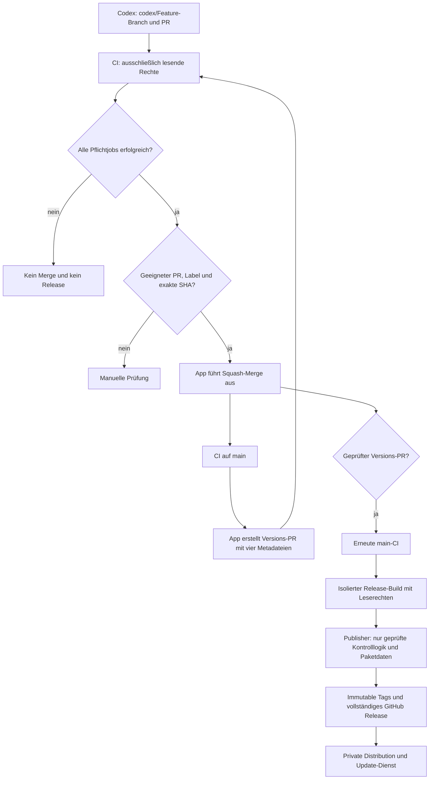

# Automatisiertes CI/CD: Freigabe, Betrieb und Berechtigungen

## Status dieses Entwurfs

Diese Änderung wird ausschließlich als Draft-PR vorbereitet. Sie führt keinen
Merge aus, erstellt keinen Release-Tag und veröffentlicht keine Pakete.
`KIOSKY_CICD_ENABLED` muss bis zur ausdrücklich genehmigten Aktivierung fehlen
oder `false` sein. Repositoryeinstellungen, Secrets, Apps und Sichtbarkeit
werden durch den PR nicht geändert.

Am 17.10.2026 beobachtete Freigabeblocker:

- Root-pnpm-Audit: 5 hohe und 1 mittlerer Befund.
- Update-Service-Audit: 24 hohe, 1 kritischer, 6 mittlere und 1 niedriger Befund.
  Unter anderem sind transitive Pakete und die Buildtoolchain betroffen.
  Ein ungeprüftes `npm audit fix --force` würde direkte Versionen ändern und
  wird hier nicht ausgeführt. Befunde in separaten geprüften Änderungen beheben.
- `soerenelvers/kiosky-distribution` ist laut GitHub-API derzeit **öffentlich**,
  obwohl die gewünschte Architektur eine private Distribution voraussetzt.
  Der Publisher bricht bei einer öffentlichen Distribution ab. Sichtbarkeit erst
  nach eigener Prüfung vorhandener Kunden-/Composer-Zugriffe ändern.
- Aktuelle Branch-/Actions-Adminregeln konnten mit der vorhandenen Integration
  nicht gelesen werden (HTTP 403). Sie müssen vor Aktivierung geprüft werden.
- Während der Vorbereitung wurde PR #17 mit manuellen Eigentümerfreigaben
  auf main zusammengeführt. Der Feature-Branch enthält diesen Stand; der Übergang
  ist in [Eigentümerfreigabe](codex-approval-workflow.md) beschrieben. Die neue
  automatische Richtlinie ersetzt ihn ausschließlich nach separater Aktivierung.
- Ein weiterer Draft-PR #18 zu Release-Entwürfen existiert bereits. Dieser Entwurf
  ersetzt dessen Ansatz durch eine vollständig getrennte Kontroll-/Build-Ebene;
  beide Änderungen vor einem späteren Merge auf Überschneidungen prüfen.

## Ablauf

Ein normaler Merge erzeugt zunächst einen **Versions-PR**, keinen direkten
ungeschützten Versionscommit auf `main`. Auch dieser PR durchläuft alle Tests,
wird kontrolliert zusammengeführt und erhält anschließend erneut main-CI.
Die App erzeugt echte Folgeereignisse; sie umgeht nicht die Ereignisunterdrückung
des eingebauten `GITHUB_TOKEN` durch ungesicherte Dispatch-Workarounds.

Ohne Versionslabel wird die Patchversion erhöht. Genau eines von `release:patch`,
`release:minor`, `release:major` steuert den Schritt. Mehrere Labels brechen ab.
`VERSION`, `package.json`, README und CHANGELOG werden gemeinsam erzeugt;
CMS-Versionen folgen den bestehenden Buildplatzhaltern. Vorhandene Tags und
Changelogversionen werden nicht überschrieben. Ein bereits offener bot-eigener
Versions-PR wird ohne Force-Push aus dem zuletzt geprüften main-Stand aktualisiert;
bei manuellen Änderungen oder inkonsistenten Metadaten wird abgebrochen.
Mehrere nahe aufeinanderfolgende Merges dürfen gemeinsam in einen Versions-PR
fließen. Bei veraltetem main-CI-Stand bricht der Publisher ab; unter Last können
Versionslücken entstehen, niemals ein ungeprüftes Zurücksetzen von main.

## Wann wird automatisch zusammengeführt?

Alle Bedingungen müssen zutreffen:

- Aktivierungsschalter eingeschaltet; `CI gate` des echten `.github/workflows/ci.yml`
  erfolgreich; Run-Identität wird über die GitHub-API verifiziert.
- Gleiche Source-/Head-Repository-Identität, kein Fork, PR-Ziel `main`, kein Draft.
- PR-Head stimmt exakt mit der getesteten Commit-ID überein; Basis aktuell,
  GitHub meldet einen konfliktfreien, regulär zusammenführbaren Stand.
- Explizites Label `automerge` und exakte Autorenfreigabe.
- Normale Codex-PRs verwenden `codex/…`; Änderungen an Workflows, Kontrolllogik,
  Build-/Release-Skripten, AGENTS, zentralen Versionen oder Dependency-/Lockdateien
  bleiben von Auto-Merge ausgeschlossen. Auch alte Pfade umbenannter Dateien zählen.
- Bot-Versions-PRs verwenden `release/…` und `release:prepared`; nur die vier
  erwarteten Metadateien sind erlaubt. Deren vollständiger Inhalt wird vor Merge
  gegen die deterministisch erzeugte Änderung geprüft.

Die GitHub-App ist kein Administrator und erhält keinen Branchschutz-Bypass.
Branchschutz bleibt zusätzlich wirksam. Native GitHub-„Allow auto-merge“ ist für
die verwendete, nach allen Prüfungen ausgeführte Squash-Merge-API nicht erforderlich.
Dieser Draft-PR ändert geschützte Pfade und ist selbst niemals auto-mergefähig.

## Pflichtprüfungen

`CI gate` verlangt `success` für alle vier Gruppen; übersprungene, abgebrochene
oder fehlgeschlagene Jobs werden nicht als Erfolg gewertet:

1. **Application:** Frozen install, TypeScript, Anwendungstests, Release-Tests,
   Kontrolllogik-Regressionen, PHP-Verträge, Versionskonsistenz, drei Plattform-ZIPs.
2. **PHP:** PHP 8.2/8.3/8.4 × TYPO3 13.4/14.3; Metadaten, Syntax, Verträge,
   reale Composer-Auflösung und Audit der erzeugten Lockdatei in einem Tempordner.
   Paketplugins und Scripts bleiben bei der reinen Auflösung deaktiviert.
3. **Security:** pnpm-Audit ab `high`, npm-Audit des Update-Service-Lockfiles ab
   `high`, Suche nach eingecheckten Zugangsdaten und gepinntes actionlint.
   Es gibt kein `continue-on-error`. Composer meldet aufgegebene Pakete separat;
   `--abandoned=report` unterdrückt keine Sicherheitsadvisories.
4. **CMS runtime:** echter WordPress-Upgrade mit temporärer MariaDB, Medien-/API-
   Smoke-Tests, echte TYPO3-13-/14-Classic-Upgrades und Composer-Upgrades.
   Vorherige stabile ZIPs kommen mit einem ausschließlich lesenden Source-Token
   aus den GitHub Releases. Ein temporäres lokales VCS-Fixture benötigt keinen
   privaten Distributionsschlüssel. Fehlende vorherige Pakete brechen Tests ab.

Geplante Sicherheitsläufe verwenden denselben lesenden CI-Workflow. Es wird kein
Sicherheitscheck nur wegen fehlender Lizenz stillschweigend als bestanden gewertet.
CodeQL/GitHub Advanced Security ist hier nicht vorausgesetzt; für zusätzliche SAST
muss dessen Verfügbarkeit getrennt geprüft und ein Pflichtcheck ergänzt werden.

## Trennung der Rechte

- Tests, PHP, CMS und Builds: `GITHUB_TOKEN` nur `contents: read`, keine
  Produktionssecrets, Checkout ohne gespeicherte Credentials.
- Auto-Merge und Versionssteuerung: GitHub-App-Token nur in einem separaten Job.
  Checkout ausschließlich `.github/automation` aus `github.workflow_sha`, also
  der überprüften Default-Branch-Kontrolllogik. Niemals PR-Head-Code ausführen.
- Publisher: gleicher vertrauenswürdiger Kontrollcode; kein pnpm/npm/Composer,
  keine Lifecycle-Skripte, kein PHP aus ZIPs, kein Wiederverwenden von Buildcaches.
  ZIP-Dateien werden ausschließlich als Daten gelesen, niemals ausgeführt.
- Alle verwendeten externen Actions sind auf vollständige Commit-IDs fixiert.
  Workflow- und Kontrollcodeänderungen benötigen explizite Owner-Prüfung.

Der Publisher verifiziert die SHA des erfolgreich getesteten main-Stands erneut,
die sieben erwarteten Dateien, sämtliche SHA-256-Einträge, übereinstimmende
Manifeste, Versionen, Source-Commit und Downloadziele. Die ZIP-Leselogik verweigert
Traversal, Links/Geräte, doppelte Pfade, übergroße Inhalte, Verschlüsselung,
unbekannte Kompression und CRC-Fehler. GitHub-Assets müssen nach Upload vollständig
mit erwarteten Größen und serverseitigen SHA-256-Digests vorliegen.

## Erforderliche Apps und Berechtigungen

| Identität | Repository-Zugriff | Minimale Berechtigungen |
| --- | --- | --- |
| Codex-Integration | Nur `soerenelvers/kiosky` | Contents write und Pull requests write; zum Push dieses Workflow-PR zusätzlich die passende Workflows-Berechtigung der Integration. Kein Admin-/Release-Bypass. |
| Source-Automation-App | Nur `soerenelvers/kiosky` | Contents write, Pull requests write, Issues write (Labels), Actions read, Metadata read. Kein Administration-/Workflow-Schreibrecht. |
| Distributions-App | Nur `soerenelvers/kiosky-distribution` | Contents write, Metadata read. Keine Quellcode-/PR-/Adminrechte. |
| Normaler CI-Token | Aktuelles Source-Repository | Contents read; Kontrolljobs zusätzlich Actions/Pull requests read. |
| Update-Adminzugang | Nur eingerichteter Update-Dienst | Upload und Veröffentlichung geprüfter Releaseobjekte. |

App-Schlüssel sind ausschließlich Environment-Secrets mit Default-Branch-Beschränkung.
So erhalten PR-Runner die Schlüssel auch dann nicht, wenn ein PR seine Workflowdatei
um eine Secret-Referenz erweitert. Diese Settings sind vor Aktivierung verpflichtend.

Die Token-Actions beschränken jede ausgestellte Installation-Session noch einmal
auf das angegebene Repository und die tatsächlich benötigten Rechte. Es gibt
keinen unsichtbaren PAT-Fallback. Kurzlebige Tokens werden nach dem Job widerrufen.
Der bisherige Distributions-SSH-Key wird von dieser neuen Pipeline nicht mehr
verwendet; er wird durch den Draft nicht gelöscht oder verändert.

## Variablen und Secrets

| Name | Art und Ort | Wert/Zweck |
| --- | --- | --- |
| `KIOSKY_CICD_ENABLED` | Repositoryvariable | Bis zur Freigabe `false`; danach `true`. |
| `KIOSKY_AUTOMATION_APP_ID` | Repositoryvariable | Source-App-ID. |
| `KIOSKY_AUTOMATION_PRIVATE_KEY` | Separates Secret in den Environments `automation` und `release` | PEM-Schlüssel der Source-App; niemals ungeschütztes Repositorysecret. |
| `KIOSKY_AUTOMATION_BOT` | Repositoryvariable | Exakter GitHub-Login, z. B. `kiosky-automation[bot]`. |
| `KIOSKY_AUTOMERGE_AUTHORS` | Repositoryvariable | JSON-Liste ausdrücklich zugelassener Codex-Autoren; Standard `[]` sperrt normale PRs. |
| `KIOSKY_DISTRIBUTION_REPOSITORY` | Repositoryvariable | Genau `soerenelvers/kiosky-distribution`. |
| `KIOSKY_DISTRIBUTION_APP_ID` | Repositoryvariable | App-ID für die Distribution. |
| `KIOSKY_DISTRIBUTION_PRIVATE_KEY` | Secret im Environment `release` | PEM-Schlüssel der reinen Distributions-App. |
| `KIOSKY_UPDATE_BASE_URL` | Repositoryvariable | HTTPS-Origin des bestehenden Dienstes, ohne Pfad/Query/Zugangsdaten. Pflicht; bei fehlender Konfiguration keine Veröffentlichung. |
| `KIOSKY_UPDATE_ADMIN_TOKEN` | Secret im Environment `release` | Bestehender, minimal berechtigter Adminzugang des Update-Dienstes. |

Secrets ausschließlich in GitHub Settings eintragen; keine Werte in PRs, Logs,
Konfigurationsbeispielen oder Paketdateien hinterlegen.

## Einmalige Einrichtung nach menschlicher Freigabe

1. Diesen Draft samt Kontrolllogik prüfen; zunächst nicht mergen oder aktivieren.
2. Bestehende hohen/kritischen Auditbefunde in geprüften Änderungen beheben.
3. Source-App und Distributions-App anlegen und nur auf den genannten Repositories
   installieren. Adminrechte oder pauschale Branchschutz-Bypässe nicht gewähren.
4. Labels `automerge`, `release:prepared`, `release:patch`, `release:minor`,
   `release:major` anlegen; Variablen und Secrets sicher konfigurieren.
5. `main` schützen: PR erforderlich, Pflichtcheck `CI gate`, strikt aktuelle Basis,
   erforderliche allgemeine Approvals für geeignete PRs auf 0 setzen, keine
   Force-Pushes/Branchlöschung, keine App-Bypässe; Code-Owner-Prüfung für
   Kontroll-/Workflowdateien. Keine pauschale Freigabepflicht für jeden PR, wenn
   der spätere Betrieb automatisch sein soll. `package.json`, VERSION und
   CHANGELOG haben bewusst keinen pauschalen Code Owner: nur der deterministisch
   geprüfte Bot-Versions-PR darf diese automatisch ändern; normale PRs mit solchen
   Änderungen sind durch die Controllerpolicy von Auto-Merge ausgeschlossen.
6. Die Environments `automation` und `release` auf Default-Branch-Ausführungen
   beschränken; PR-/Feature-/Tag-Refs ausdrücklich ausschließen. Den Source-App-Key
   in beiden Environments getrennt hinterlegen, nicht als Repositorysecret.
   `GITHUB_TOKEN` standardmäßig auf read-only und PR-Freigabe durch Actions auf aus
   setzen. Regeln für `v*`-Tags auf den Publisher-App-Akteur beschränken.
   Environment `release` für die Erstfreigabe mit einem erforderlichen menschlichen
   Reviewer schützen.
   Soll der spätere Betrieb vollständig automatisch laufen, diese einzelne
   Deploymentfreigabe erst nach ausdrücklicher dauerhafter Genehmigung entfernen;
   Branchschutz, CI gate und Kontrollcode-Review bleiben bestehen.
7. Distributionssichtbarkeit und erforderliche Kundenlesezugriffe prüfen und
   anschließend separat privat konfigurieren. Update-Dienst und Scope prüfen.
8. Erst nach geprüftem Merge dieses PRs und grünen Pflichtprüfungen den Schalter
   `KIOSKY_CICD_ENABLED=true` setzen. Ein späterer echter, geeigneter Codex-PR
   durchläuft dann automatisch Merge → Version-PR → CI → Release.

Der aktuelle Entwurf ändert keine dieser Repositoryeinstellungen. Dass normale
Git-/PR-Operationen funktionieren, belegt keinen Adminzugriff.

## Reihenfolge und Fehlerbehandlung beim Veröffentlichen

Vor Schreibzugriffen: alle lokalen Artefakte validieren, Source-/Distributions-
Version auf Nichtexistenz prüfen, privaten Zielstatus und Update-Dienst prüfen.
Unbekannte API-Fehler werden nicht als „Version fehlt“ interpretiert.

Dann: Distributionsobjekte ohne Ref-Promotion erzeugen; alle Update-Dateien
stagen und Serverdigests prüfen; unveränderlichen Source-Tag und GitHub-Draft
mit allen sieben Assets erzeugen und prüfen; Distributions-Tag veröffentlichen;
vollständiges Source-Release veröffentlichen; Distributions-main ohne Force
aktualisieren; Update-Dienst erst zuletzt auf stable schalten. Die unabhängige
`docs/`-Dokumentation der Distribution bleibt erhalten.

Zwischen GitHub, einer zweiten Git-Repository-Referenz und einem externen Dienst
gibt es keine globale Transaktion. Ein Infrastrukturfehler kann nach erfolgreicher
Paketprüfung zu einer **teilweisen Freigabe** führen. Der Workflow meldet das als
Fehler und überschreibt keine Tags oder bestehenden Releases. Ein Wiederanlauf
mit bereits belegter Versionsnummer stoppt bewusst; keine `--clobber`-Option.

Zur Wiederherstellung zuerst Tags, Assets, Manifesthashes und Dienststatus anhand
der Run-ID prüfen. Eine fehlende Promotion nur nach expliziter Betreiberfreigabe
mit denselben geprüften Artefakten fortsetzen oder eine neue korrigierende Version
vorbereiten. Keine Tags verschieben, keine produktiven Assets ersetzen und keinen
Rollback ohne passende Datenbanksicherung behaupten. `KIOSKY_CICD_ENABLED=false`
stoppt neue Automatisierungsläufe; laufende Jobs gegebenenfalls zusätzlich abbrechen.

## Verifikation dieses Drafts

Lokal bestanden: Frozen install, lint, 162 Anwendungstests, 7 Release-Tests,
15 Kontrolllogik-Tests, sechs PHP-Vertragsskripte, Plattform-/Releasebuild,
Validierung der sieben tatsächlich gebauten Release-Dateien sowie actionlint.
Beide aktuellen TYPO3-Abhängigkeitsgraphen konnten unter PHP 8.4 aufgelöst und
ohne Sicherheitsadvisories auditiert werden.

[GitHub-Probelauf 39054788668](https://github.com/soerenelvers/kiosky/actions/runs/39054788668)
auf dem ersten Draft-Stand: Application, alle sechs PHP-/TYPO3-Kombinationen und
CMS runtime bestanden. Die echten WordPress-/TYPO3-Installations- und Upgradetests
wurden dort ausgeführt. Security scheiterte ausschließlich an den dokumentierten
pnpm-/npm-Befunden; `CI gate` verweigerte deshalb korrekt die Freigabe. Nachfolgende
Kontrolllogik-/Environment-Härtungen werden auf demselben Draft erneut geprüft.
Produktive Veröffentlichungsoperationen wurden ausschließlich mit API-Fixtures
getestet, nicht gegen die tatsächlichen Distribution-/Update-Endpunkte ausgeführt.

## Eigentümer-Release ab 3.3.8

Der Eigentümer hat Commit, Push, Merge und Release ausdrücklich beauftragt.
`.github/workflows/manual-release.yml` erhält dafür den bewährten manuellen
GitHub-Distributionsweg, ohne die App-Automatik zu aktivieren. Ein zunächst nur
lesender Job prüft Eigentümer, Bestätigung, aktuelle main-SHA und vollständige
erfolgreiche CI samt CI gate. Erst danach darf der nachgeschaltete Job mit
Schreibberechtigung den getesteten main-Code bauen und die bestehenden realen
CMS-Installations-/Upgrade-Gates ausführen. Geändertes main oder vorhandene
Versionen verhindern die Veröffentlichung. Die bestehende Distributionssichtbarkeit
wird nicht geändert. Es werden die vorhandenen SSH-Zugangsdaten verwendet.

Die Befunde vom 17.10. oben beschreiben den damaligen Stand. Für 3.3.8 besteht
der Root-Audit ohne Befunde; der Update-Service hat keine hohen/kritischen und
acht mittlere Befunde. Details und getestete Sicherheits-Overrides stehen in
[security.md](security.md). Die bislang nicht konfigurierte Update-Service-URL
und die App-/Environment-Einrichtung bleiben getrennte Aufgaben; weder
CI-Status noch ein GitHub-Release bedeuten einen automatischen Kundenserver-Neustart.
