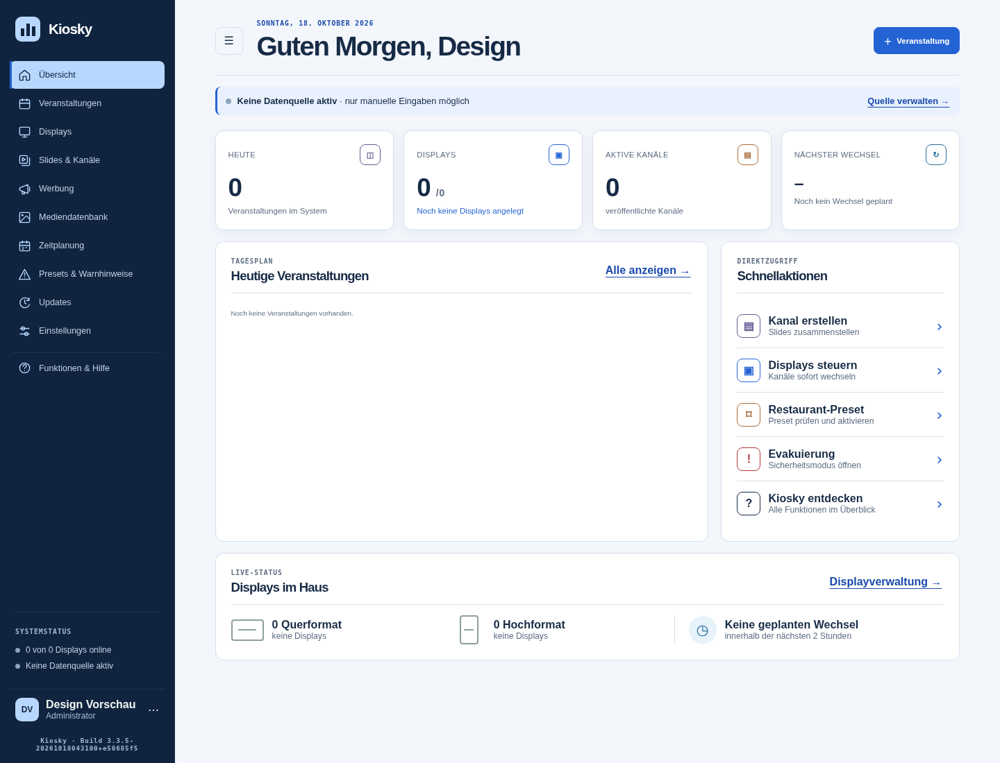

# Blaues Oberflächendesign

Die gemeinsame Verwaltungsoberfläche erhält eine dunkelblaue Navigation, hellblaue Auswahlzustände und blaue Hauptaktionen. Helle neutrale Flächen, abgerundete Karten und einheitliche Navigationssymbole lösen die grün-limettenfarbene Gestaltung ab. Die Oberflächen und Editor-Markierungen verwenden dieselbe Palette in Standalone, WordPress und TYPO3.

## Vorschau

Lokale Testinstallation mit Beispieldaten; keine Produktionsdaten.

[Mobile Übersicht ansehen](design/blue-mobile.png)

## Aufräumen und Bedienbarkeit

- Der Benachrichtigungsknopf hatte weder einen Klick-Handler noch eine Benachrichtigungsfunktion. Er und sein dauerhafter Hinweis-Punkt entfallen. Alle übrigen 761 HTML-Steuerelemente einschließlich Formulare und Dialoge bleiben erhalten; IDs, Formulartypen und Aktionsattribute wurden mit dem vorherigen Stand verglichen.
- Die dekorativen Kennziffern 01–04 an den Kennzahlen entfallen.
- „Auf 3 Displays aktivieren“ wird durch „Preset prüfen und aktivieren“ ersetzt. Der bestehende Preset-Aufruf bleibt erhalten.
- Das Kiosky-Logo führt jetzt auch innerhalb der geöffneten Anwendung zur Übersicht. Die Navigation markiert die aktive Seite mit `aria-current="page"`; die neuen SVG-Symbole sind für Screenreader dekorativ.
- Display- und Datenquellenpunkte zeigen nur bei einem vorhandenen Online-Player beziehungsweise einer ausgewählten aktiven Quelle einen aktiven Zustand. Der Quellpunkt bescheinigt keine erfolgreiche Verbindung. Statusbeschriftungen bleiben erhalten.
- Tastaturfokus, mobile Navigation und die drei mobilen Editor-Panels bleiben zugänglich. Reduzierte Bewegung betrifft ausschließlich die Verwaltungsanimationen; Laufschriften und Player-Animationen behalten ihre Funktion.

## Technische Grenzen

Die Änderung betrifft CSS, Navigationsauszeichnung und kleine Anzeige-Handler. Es gibt keine Datenmigration oder Änderung an APIs, Rechten, Speichern, Imports und Exporten. Der freigegebene Release wird als Version 3.3.6 vorbereitet. Benutzerdefinierte Slide-Farben, gespeicherte Vorlagen, Warnungsinhalte und Player-Inhalte werden nicht umgefärbt. Grün als inhaltliche oder semantische Farbe kann dort weiterhin vorkommen.

Die bisherigen CSS-Variablen `--green`, `--green-dark`, `--green-pale` und `--acid` bleiben als Aliase erhalten. Die neue Palette verwendet `--accent`, `--accent-dark`, `--accent-pale` und `--accent-light`. Damit bleiben vorhandene Selektoren und Erweiterungen anschlussfähig. Fehler, Warnungen und Erfolgsmeldungen behalten ihre unterscheidbaren Zustände.

## Verifikation

Lokal unter Node.js 24, pnpm 11.9.0 und PHP 8.4 ausgeführt:

| Prüfung | Ergebnis |
| --- | --- |
| `pnpm install --frozen-lockfile` | Erfolgreich; Sicherheits-Patches für brace-expansion und js-yaml im Lockfile |
| `pnpm lint` | Erfolgreich |
| `pnpm test` | 164 erfolgreich, keine übersprungen |
| `pnpm test:release` | 7 erfolgreich |
| `pnpm test:php` | Alle sechs PHP-Testskripte erfolgreich |
| `pnpm build:platforms` | Standalone, WordPress und TYPO3 erfolgreich |
| Paketinhalt | Alle drei ZIPs enthalten bytegleich das neue gemeinsame Stylesheet |
| Neue Regressionstests | WCAG-AA-Kontrast der zentralen Text-/Aktionsfarben; tatsächliche Display-Zähler und aktive/inaktive Zustände |

Zusätzlich mit echtem Chromium und isolierter SQLite-Testdatenbank geprüft:

- Alle elf Hauptansichten auf 1440 Pixel Breite und zusätzlich auf 390 und 768 Pixel Breite geöffnet, aktive Navigation geprüft; kein horizontaler Seitenüberlauf.
- Sichtbare, aktivierte Knöpfe der Hauptansichten auf direkte oder delegierte Klick-Handler beziehungsweise Formularaktionen geprüft: keine unverdrahteten Knöpfe gefunden. Das ist eine Verdrahtungsprüfung, kein vollständiger Test sämtlicher Geschäftsaktionen.
- Veranstaltung angelegt, gespeichert und nach Neuladen wiedergefunden.
- Slide mit Textelement erstellt und gespeichert; Kanal angelegt, Slide zugeordnet, Kanal gespeichert und Vorschau geöffnet.
- Display angelegt und nach Neuladen wiedergefunden.
- Kontodialog mit Tastatur geöffnet, Logo-Navigation, sichtbarer Tastaturfokus und reduzierte Bewegung geprüft.
- Mobile Editor-Werkzeuge, Ebenen und Eigenschaften geöffnet.
- Keine JavaScript-Laufzeitfehler in den geprüften Abläufen.

Externe Live-Dienste und produktive CMS-Installationen wurden nicht bedient. Die lokalen PHP-Vertragstests und Paket-Builds ersetzen keinen vollständigen Live-Test jeder Integration.

## Einführung und Rücknahme

Die Änderung wurde als Draft-PR vorbereitet. Der Eigentümer hat anschließend Commit, Merge und Release ausdrücklich als Standardablauf beauftragt. Merge und Veröffentlichung setzen erfolgreiche Prüfungen und die vorhandenen Release-Sperren voraus. Zur Rücknahme genügt ein Revert des Design-Commits; Datenbank und gespeicherte Inhalte benötigen keine Rückmigration.
